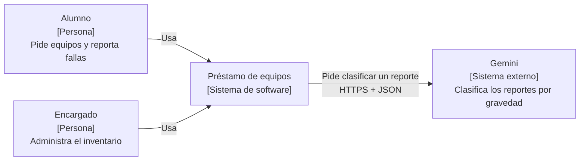
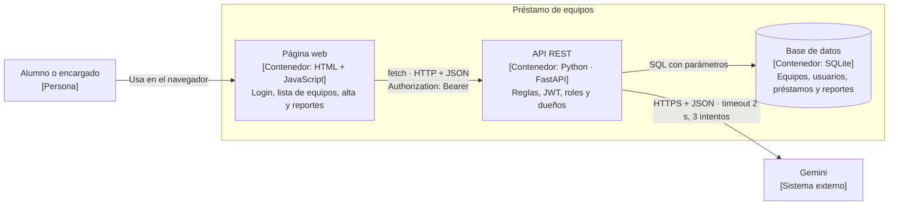

# Arquitectura

## Nivel 1 · Contexto

## Nivel 2 · Contenedores

## Qué pasa si algo falla

| Si falla... | Qué responde la API | Por qué |
|---|---|---|
| Gemini tarda más de 2 segundos en los 3 intentos | 504 | La API no se queda esperando: avisa en segundos y el front muestra el mensaje. |
| Gemini responde un error o algo que no es JSON | 502 | El problema es del otro servicio, no de la petición del usuario. |
| Falta `GEMINI_API_KEY` | 503 | El servicio no está configurado; el resto de la API sigue funcionando. |
| La página viene de un origen que no está en la lista | El navegador bloquea | CORS protege al usuario de páginas ajenas. |
