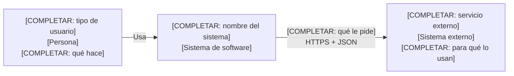
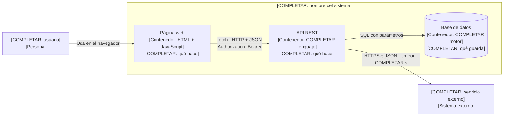

# Arquitectura

<!-- Modelo C4 (Simon Brown): se dibuja por niveles, del más general al más detallado.
     Para su proyecto bastan el nivel 1 (contexto) y el nivel 2 (contenedores).
     Cada caja dice: nombre, [tipo y tecnología] y para qué sirve.
     Cada flecha dice: qué se pide y por qué medio (HTTP + JSON, SQL...). -->

## Nivel 1 · Contexto: quién usa el sistema y con qué otros sistemas habla

## Nivel 2 · Contenedores: las piezas que se ejecutan por separado

<!-- Un "contenedor" en C4 es cualquier cosa que corre por su cuenta: la página, la API, la base de datos.
     Aquí se ve lo DISTRIBUIDO de su proyecto: cada flecha es un mensaje por la red. -->

## Qué pasa si algo falla

| Si falla... | Qué responde la API | Por qué |
|---|---|---|
| [COMPLETAR: el servicio externo tarda] | [COMPLETAR: 504] | [COMPLETAR] |
| [COMPLETAR: el servicio externo responde un error] | [COMPLETAR: 502] | [COMPLETAR] |
| [COMPLETAR: falta la clave del servicio] | [COMPLETAR: 503] | [COMPLETAR] |
