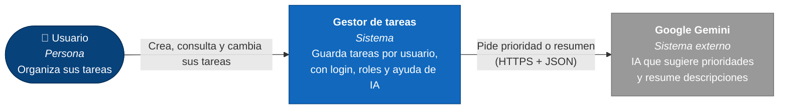
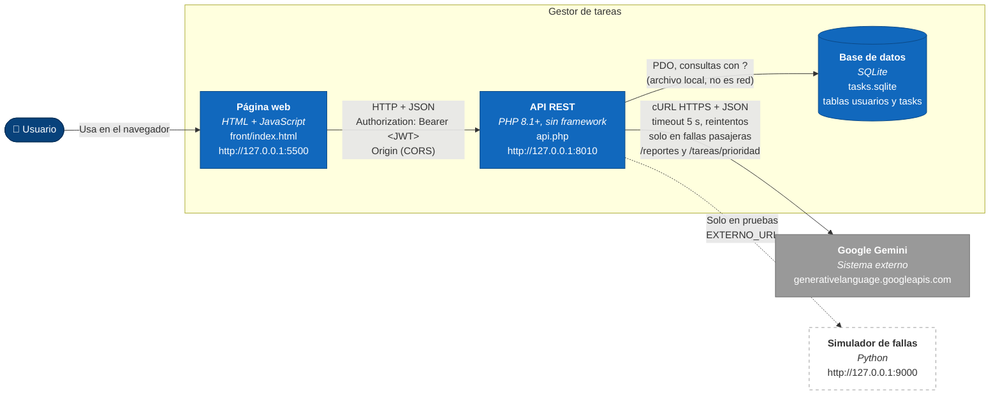
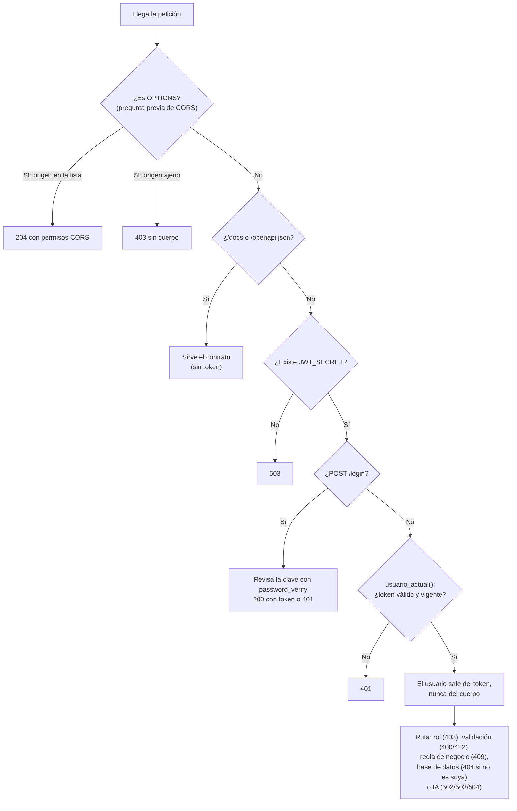

# Arquitectura

Gestor de tareas: una página web, una API REST en PHP, una base SQLite y una IA externa (Google Gemini). Los diagramas siguen el modelo C4 (nivel 1: contexto, nivel 2: contenedores) y están en Mermaid, así que GitHub los dibuja solos.

## Nivel 1 · Contexto

Quién usa el sistema y con qué sistemas externos habla.

## Nivel 2 · Contenedores

Las piezas que se ejecutan por separado y cómo se comunican.

| Contenedor | Tecnología | Qué hace |
|---|---|---|
| **Página web** | HTML y JavaScript (`fetch`), servida con `python3 -m http.server 5500` | Login, lista de tareas, alta con errores por campo y consulta a la IA (`POST /reportes`). Guarda el token y lo manda en cada petición |
| **API REST** | PHP 8.1+ sin framework, un solo archivo `api.php`, `php -S 127.0.0.1:8010` | Revisa CORS, el token y el rol; valida datos; aplica las reglas de negocio; lee y escribe en la base; llama a la IA. También sirve el contrato en `/docs` y `/openapi.json` |
| **Base de datos** | SQLite con PDO | Tabla `usuarios` (contraseñas con `password_hash`, bcrypt) y tabla `tasks` (cada tarea con su `usuario_id`). Restricción `UNIQUE (usuario_id, titulo, fecha_limite)` |
| **Google Gemini** | API REST de Google (modelo `gemini-flash-lite-latest`) | Responde en JSON la prioridad (`alta`, `media` o `baja`) y una razón o un resumen |
| **Simulador** | `simulador.py` (lo arranca `probar_api.py`) | Imita a Gemini lento, caído, con error 400 o respondiendo basura, para probar las fallas sin depender de Google |

`POST /tareas/prioridad` no lo usa la página: se prueba desde `/docs`, con `curl` o con `probar_api.py` (pruebas 21 a 25).

## Qué está distribuido

El sistema tiene **tres procesos separados que se hablan por la red con HTTP**:

1. **La página web** corre en el navegador del usuario y se carga desde el puerto 5500.
2. **La API** corre en otro proceso, en el puerto 8010.
3. **Gemini** corre en los servidores de Google, en internet.

Por estar separados aparecen dos problemas que un programa de un solo proceso no tiene, y la API resuelve cada uno:

- **CORS.** El puerto 5500 y el 8010 son *orígenes distintos*, así que el navegador pregunta antes (`OPTIONS`) si la página puede usar la API. La API responde con una lista de orígenes permitidos (`CORS_ORIGIN`), nunca con `*`, y lo hace **antes** de revisar el token.
- **Fallas de la red.** Gemini puede tardar, saturarse o responder algo raro. La API pone un tiempo máximo de 5 s, reintenta solo las fallas pasajeras y siempre contesta un error JSON claro (502, 503 o 504). Nunca se queda colgada.

**La base de datos no está distribuida:** `tasks.sqlite` es un archivo en la misma máquina que la API y PDO lo abre directamente, sin pasar por la red. Por eso esa flecha dice "archivo local".

| Flecha | ¿Mensaje por la red? | Protocolo |
|---|:---:|---|
| Página web → API | Sí | HTTP + JSON, token en `Authorization: Bearer` |
| API → Gemini | Sí | HTTPS + JSON con cURL, clave en `x-goog-api-key` |
| API → Base de datos | **No** | PDO sobre un archivo local |

## Recorrido de una petición dentro de la API

El orden en `api.php`, de arriba hacia abajo:

Si en cualquier punto ocurre un error inesperado, `set_exception_handler` responde **500 en JSON** sin trazas y lo registra en la consola del servidor.

## Fallas en la comunicación y qué hace la API

| Falla | Código | Qué hace la API |
|---|:---:|---|
| La IA tarda más de 5 s | **504** | `CURLOPT_TIMEOUT => 5` corta la llamada. El timeout **no** se reintenta |
| La IA responde 429 o 503 (saturada, pasajero) | — | Reintenta. `/reportes`: 1 reintento inmediato. `/tareas/prioridad`: hasta 2 reintentos (también con 500, 502 y 504) esperando 0.5 s y 1 s. Si sigue fallando: **502** |
| La IA responde 400 u otro error que no es pasajero | **502** | No reintenta: repetir lo mismo no lo arregla |
| No hay conexión con la IA (DNS, red caída) | **502** | Responde de inmediato, sin reintentar |
| La IA responde basura (HTML, JSON sin los campos, prioridad inventada) | **502** | Valida la respuesta antes de usarla |
| Falta `GEMINI_API_KEY` | **503** | Solo los dos endpoints con IA; el CRUD sigue funcionando |
| Falta `JWT_SECRET` | **503** | Toda la API, excepto `/docs`, `/openapi.json` y CORS |
| Página de un origen que no está en `CORS_ORIGIN` | **403** en `OPTIONS` | El navegador bloquea la respuesta |
| Token ausente, alterado o vencido | **401** | El usuario tiene que volver a entrar |

Catálogo completo con cada mensaje: [errores.md](errores.md). Decisiones detrás de este diseño: [ADR 0001](decisiones/0001-uso-de-sqlite-y-sentencias-preparadas.md) y [ADR 0002](decisiones/0002-timeout-y-reintentos-ia.md).
